<div align="center">
  
  
</div>

# MuFASA — Multimodal Fusion Architecture for Sensor Applications

[](https://pypi.org/project/mufasa-fusion/)
[](https://pypi.org/project/mufasa-fusion/)
[](https://github.com/mufasa-fusion/mufasa-fusion/actions/workflows/tests.yml)
[](https://github.com/mufasa-fusion/mufasa-fusion/blob/main/LICENSE)

**📖 [Documentation](https://mufasa-fusion.org)** ·
[Getting Started](https://mufasa-fusion.org/latest/getting-started.html) ·
[User Guide](https://mufasa-fusion.org/latest/user-guide/index.html) ·
[API Reference](https://mufasa-fusion.org/latest/api/index.html) ·
[Contributing](https://github.com/mufasa-fusion/mufasa-fusion/blob/main/CONTRIBUTING.md)

MuFASA is a framework for rapid prototyping of geospatial sensor fusion pipelines. You don't need deep knowledge of fusion methods or sensor modalities to get started — wire nodes together with Python, run them on recorded data or live streams, and swap components without touching the rest of the pipeline.

## Installation

```bash
pip install mufasa-fusion
```

Requires Python ≥ 3.10. Optional extras, e.g. `pip install "mufasa-fusion[vis,tracking]"`:
`vis` (visualization), `tracking` (tracking nodes), `dev` (tests) and `docs` (building the documentation).
See the [Installation guide](https://mufasa-fusion.org/latest/user-guide/installation.html) for details.

## Quick start

```python
from mufasa import BoundingBox, Graph
from mufasa.io.inputs import GeoJsonInput
from mufasa.io.outputs import LocationOutput
from mufasa.nodes.mapping import POM
from mufasa.nodes.fusion import BayesianFusion
from mufasa.nodes.detection import Threshold

# Inputs: one recorded data source per sensor
sensor_a = GeoJsonInput("sensor_a.geojson")
sensor_b = GeoJsonInput("sensor_b.geojson")

# Pipeline: occupancy maps per sensor, fused, then thresholded into alarms
pom_a  = POM(decay_s=300)(sensor_a)
pom_b  = POM(decay_s=300)(sensor_b)
fused  = BayesianFusion()(pom_a, pom_b)
alarms = Threshold(threshold=0.7)(fused)
out    = LocationOutput()(alarms)

graph = Graph(
    inputs=[sensor_a, sensor_b],
    outputs=[out],
    crs="EPSG:32633",
    bbox=BoundingBox(16.4264, 48.2675, 16.4283, 48.2700),
    resolution=(2.0, 2.0),
)
graph.run()

out.result  # list of fused detections
```

`graph.plot_graph()` shows the resulting Fusion Graph:

<p align="center">
  
</p>

Continue with [Getting Started](https://mufasa-fusion.org/latest/getting-started.html) for a runnable walkthrough.

## Contributing

Contributions are welcome. Every contribution starts with an issue — please read the [Contributing guide](https://github.com/mufasa-fusion/mufasa-fusion/blob/main/CONTRIBUTING.md) and our [Code of Conduct](https://github.com/mufasa-fusion/mufasa-fusion/blob/main/CODE_OF_CONDUCT.md). To report a vulnerability, see the [Security policy](https://github.com/mufasa-fusion/mufasa-fusion/blob/main/SECURITY.md).

## Citation

If you use MuFASA in your research, please cite it via the [CITATION.cff](https://github.com/mufasa-fusion/mufasa-fusion/blob/main/CITATION.cff) file (GitHub's "Cite this repository" button).

## License

MuFASA is developed by the [AIT Austrian Institute of Technology](https://www.ait.ac.at) and licensed under the [Apache License 2.0](https://github.com/mufasa-fusion/mufasa-fusion/blob/main/LICENSE).
